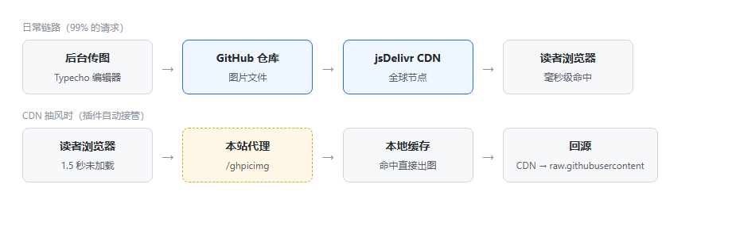
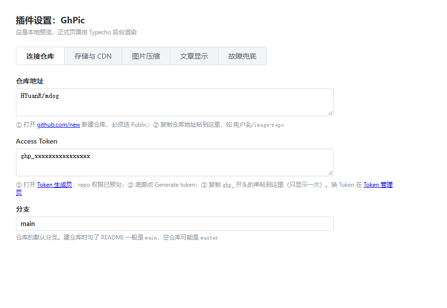
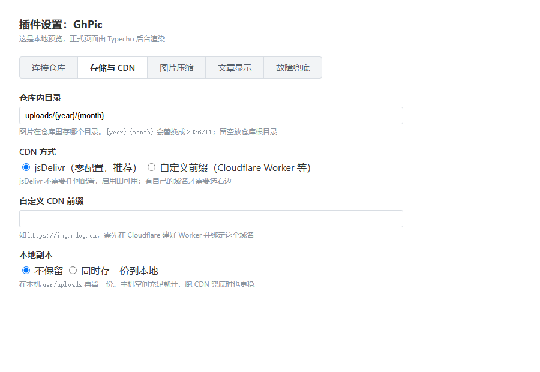
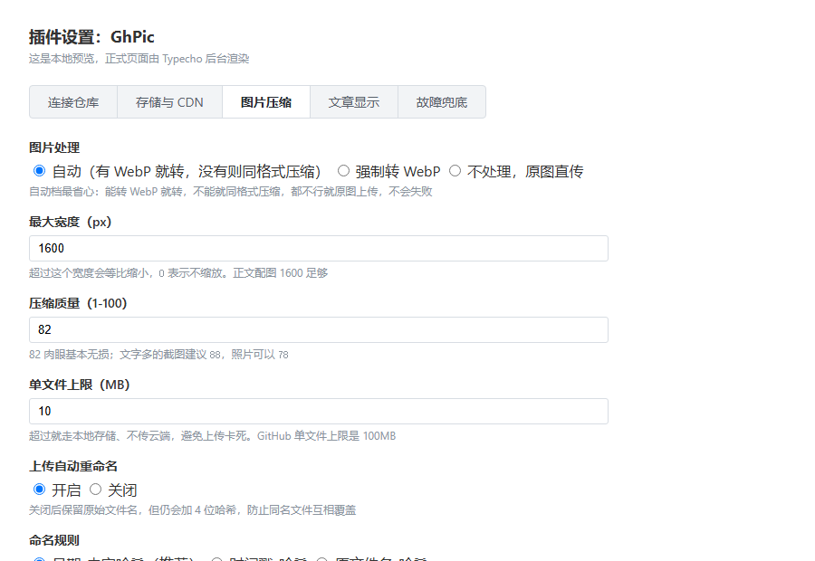
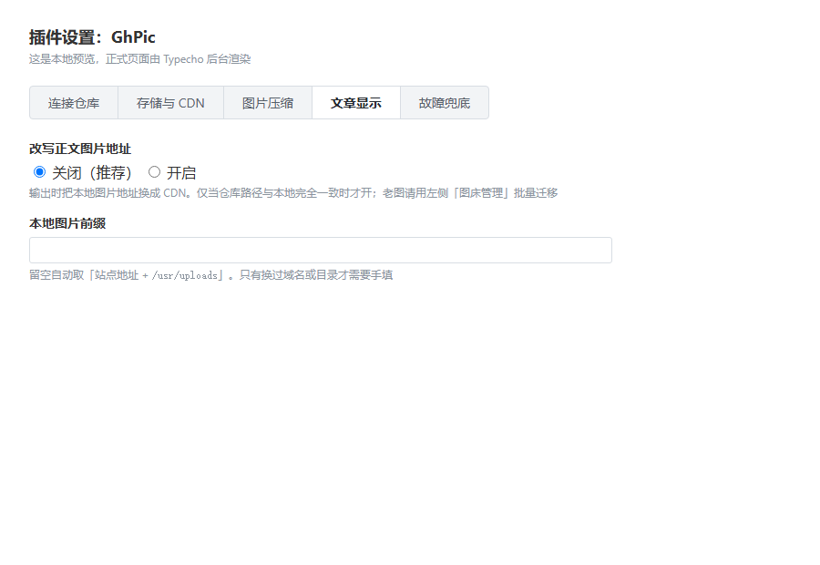
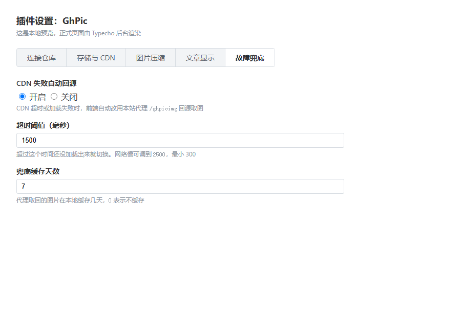

# GhPic — Typecho GitHub 图床

> 传图自动进 GitHub，CDN 加速访问，零成本不占主机空间。


后台上传图片自动推送到 GitHub 仓库，文章里直接落 jsDelivr 链接；
内置 WebP 压缩、CDN 抽风兜底、旧图批量迁移与标签管理。



---

## 目录

- [功能](#功能)
- [5 分钟上手](#5-分钟上手)
- [进阶用法](#进阶用法)
- [插件更新](#插件更新)
- [配置项](#配置项)
- [常见问题](#常见问题)
- [反馈](#反馈)
- [相关链接](#相关链接)

---

## 功能

| 功能 | 说明 |
|---|---|
| 上传直传 | 后台插图 → 推送 GitHub → 文章里直接是 CDN 链接 |
| 自动压缩 | 有 GD WebP 就转 WebP，没有则同格式重编码，都没有则原图直传 |
| 自动重命名 | 可开关，三种规则：日期-哈希 / 时间戳-哈希 / 原文件名-哈希 |
| 失败兜底 | GitHub 超时、Token 失效、文件超限 → 自动回退本地存储，**不丢图** |
| CDN 抽风回源 | 图片 1.5 秒没加载出来，前端自动切到站内代理，服务端回源并缓存 |
| 批量迁移 | 老文章的本地图片，勾选后批量推送 + 自动替换引用 |
| 标签管理 | 给图片打标签，按标签筛选、分页浏览 |
| 配置不丢 | 禁用、升级、重装插件，配置都还在 |
| 插件更新 | 设置页直连 GitHub 仓库比对文件 sha，有新版一键更新 |
| 仓库体检 | 扫出没被任何文章引用的图片，可勾选删除，释放仓库空间 |
| 防刷防盗链 | 代理端点自带单 IP 限流与 Referer 白名单，都能关 |

---

## 5 分钟上手

全程只填两个框：**仓库地址** 和 **Token**。

### 第 1 步：建一个公开仓库

1. 登录 GitHub，点右上角 `+` → **New repository**
2. **Repository name** 随便取，比如 `image-repo`
3. 可见性选 **Public**（必须，私有仓库 CDN 读不到）
4. 点 **Create repository**

建好后地址栏是 `https://github.com/你的用户名/image-repo`，记下来。

### 第 2 步：生成 Access Token

1. 直接打开这个链接（权限已经帮你勾好）：

   <https://github.com/settings/tokens/new?scopes=repo>

2. **Expiration** 建议选 90 天
3. 确认 **repo** 是勾选状态，点底部 **Generate token**
4. 复制页面上那串 `ghp_xxxxxxxx`，**只显示这一次**

> 找不到入口：头像 → Settings → Developer settings → Personal access tokens → Tokens (classic)

### 第 3 步：安装插件

把 `GhPic` 整个文件夹放到 `usr/plugins/` 下：

```
usr/plugins/GhPic/
├── Plugin.php
├── Img.php
├── panel.php
└── README.md
```

注意目录名大小写必须是 `GhPic`。

### 第 4 步：启用

后台 → 控制台 → 插件 → 找到 **GhPic** → 点 **启用**。

成功后左侧菜单会多出一项「图床管理」。

### 第 5 步：填配置

点插件右侧的 **设置**，会看到五个分段按钮。

**① 连接仓库**



- 仓库地址：填 `用户名/仓库名`，或粘贴完整地址
- Access Token：粘贴 `ghp_xxx`
- 分支：一般 `main`，仓库默认是 `master` 就改掉

保存时会自动连 GitHub 验证，成功提示「已连接账号 xxx，仓库 xxx 正常」。

**② 存储与 CDN**



默认值即可，全部不用改。

**③ 图片压缩**



默认：自动转 WebP、最大宽 1600、质量 82、单文件 10MB。
一张 800KB 的截图通常会压到 100KB 左右。

**④ 文章显示**



保持默认（关闭）。老文章用「图床管理」里的迁移功能处理。

**⑤ 故障兜底**



保持默认（开启）。CDN 抽风时靠这一页兜底。

### 第 6 步：传图验证

上传一张图，插入后地址应该是：

```
https://cdn.jsdelivr.net/gh/你的用户名/image-repo@main/uploads/2026/11/20261106-1a2b3c4d.webp
```

复制到浏览器能打开，就说明全链路通了。

---

## 进阶用法

### 迁移老文章里的图片

插件只接管**新上传**的图片。老图这样搬：

1. 左侧菜单 → **图床管理**
2. 列表显示 `usr/uploads` 下所有图片和体积
3. 勾选（支持全选），一次最多 15 张
4. 点 **迁移选中项**

每张图会执行：压缩 → 推送 → 替换文章引用，结果逐条显示：

```
✔ 2024/05/a.png → uploads/2026/11/20261106-1a2b3c4d.webp（更新 3 处引用）
```

> 「迁移成功后删除本地文件」建议**先别勾**，等前台显示都正常再回来清。

### 仓库体检（清理孤儿图片）

图片删了、文章改了，GitHub 上的文件不会自己消失，仓库只增不减。点「图床管理」里的
**扫描仓库（查孤儿）**：

- 拉取仓库全部文件，和数据库里所有文章内容比对
- 列出**没有被任何文章引用**的图片，附带 sha
- 勾选后点删除（单次 30 个），从仓库真正删掉
- 顺手告诉你本地有多少张已经托管到仓库

> 删除不可恢复，删之前建议先确认一遍：有些图可能是主题设置里引用的，不在文章正文中。

### 给图片打标签

1. 勾选若干图片
2. 顶部输入框填标签，逗号分隔，如 `教程,截图`
3. 点 **给选中项打标签**

之后用标签下拉框筛选，点列表里的标签也能直接筛；底部翻页，每页 50 张。

---

## 插件更新

设置页最后一个分段按钮「插件更新」，直连发布仓库 <https://github.com/HYuanR/GhPic>：

| 列 | 含义 |
|---|---|
| 本地 / 远端 | 两边文件的 git blob sha 前 8 位，相等即内容完全一致 |
| 大小 | 远端文件体积 |
| 状态 | 已是最新 / 有新版本 / 本地缺失 |

- 比对的是**文件内容哈希**，不是修改时间，所以不会因为时区、拷贝时间误判
- 点「更新到最新版」会依次下载 `Plugin.php`、`Img.php`、`panel.php` 并覆盖
- 旧文件自动保存为 `文件名.bak`，出问题可以手动回滚
- 只更新这三个文件，不动配置和图片
- 更新完成后建议**禁用再启用**一次插件，让新钩子生效

> 检查更新只需要读公开仓库，Token 留空也能用；如果主机访问不了 `api.github.com`，这一页会直接提示「无法连接仓库」。

---

## 配置项

### 必填

| 字段 | 默认 | 说明 |
|---|---|---|
| 仓库地址 | 空 | `用户名/仓库名` 或完整 URL |
| Access Token | 空 | 只勾 `repo` 权限 |
| 分支 | `main` | 按仓库默认分支填 |

### 存储与 CDN

| 字段 | 默认 | 说明 |
|---|---|---|
| 仓库内目录 | `uploads/{year}/{month}` | 支持 `{year}` `{month}` 占位符 |
| CDN 方式 | jsDelivr | 或自定义前缀（Cloudflare Worker） |
| 自定义 CDN 前缀 | 空 | 选自定义时填 |
| 本地副本 | 不保留 | 可同时存一份到本地 |

### 图片压缩

| 字段 | 默认 | 说明 |
|---|---|---|
| 图片处理 | 自动 | 有 WebP 转 WebP，否则同格式压缩 |
| 最大宽度 | 1600 | 超出等比缩小，0 不缩放 |
| 压缩质量 | 82 | 1–100 |
| 单文件上限 | 10 MB | 超限回退本地存储 |
| 上传自动重命名 | 开启 | 关闭后保留原名 + 短哈希 |
| 命名规则 | 日期-哈希 | 日期 / 时间戳 / 原文件名 |
| 文件名前缀 | 空 | 如 `blog-` |

### 文章显示 / 故障兜底

| 字段 | 默认 | 说明 |
|---|---|---|
| 改写正文图片地址 | 关闭 | 仅当仓库路径与本地一致时才开 |
| 本地图片前缀 | 自动 | 留空取「站点地址 + /usr/uploads」 |
| CDN 失败自动回源 | 开启 | 前端注入兜底脚本 |
| 超时阈值 | 1500 ms | 低于 300 按 300 |
| 兜底缓存天数 | 7 | 代理图片的本地缓存有效期 |
| 单 IP 每分钟上限 | 120 | 防刷，0 表示不限速 |
| 防盗链白名单 | 空 | 逗号分隔域名，留空不校验 |

---

## 常见问题

**Q：上传后图片是 `.png` 不是 `.webp`？**
主机 PHP 没编译 WebP 支持，已自动降级为同格式压缩，功能不受影响。

**Q：图片打开是 404？**
jsDelivr 对新文件有几分钟同步延迟；超过 1.5 秒会自动走兜底代理。

**Q：保存设置提示「无法连接 api.github.com」？**
主机禁止外联。在主机上执行 `curl -I https://api.github.com` 确认。

**Q：Token 会不会泄露？**
只存在你自己站的数据库，不回显、不写日志。丢了去 GitHub 撤销重发即可，已有图片不受影响。

**Q：仓库能存多少？**
GitHub 建议单仓库 1GB 以内，压缩后约 1 万张图，个人博客够用三五年。

**Q：换仓库 / 换 CDN 怎么办？**
改配置即可，新图立刻走新地址；老文章里的旧地址需要重新迁移一次。

**Q：删文章会删 GitHub 上的图吗？**
不会，插件只负责上传。

---

## 技术说明

- 入口类：`\TypechoPlugin\GhPic\Plugin`，实现 `\Typecho\Plugin\PluginInterface`
- 钩子：`Widget\Upload`(uploadHandle / attachmentHandle)、`Widget\Base\Contents`(contentEx / excerptEx)、`Widget\Archive`(footer)、`admin/menu.php`(navBar)
- 面板：`admin/extending.php?panel=GhPic/panel.php`，复用后台登录态
- 安全：CSRF 令牌 + `hash_equals`、`realpath` 前缀校验、输出全转义、Token 不回显

## 反馈

**有问题、有建议，请到这篇文章下面留言：<https://mdog.cn/archives/11/>**

作者平时不看 GitHub 的 Issues 和 Discussions，在仓库里提的问题可能收不到回复；
评论区会收到邮件提醒，处理得最快。

留言时带上这些信息能省一半时间：

- 插件版本（设置页最下面一页能看到）
- Typecho 版本、PHP 版本
- 报错提示原文，或截图
- 卡在哪一步（安装 / 填 Token / 传图 / 迁移）

## 相关链接

- 项目仓库：<https://github.com/HYuanR/GhPic>
- 图文教程：<https://mdog.cn/archives/11/>
- 备用邮箱：3037924279@qq.com

## License

MIT
